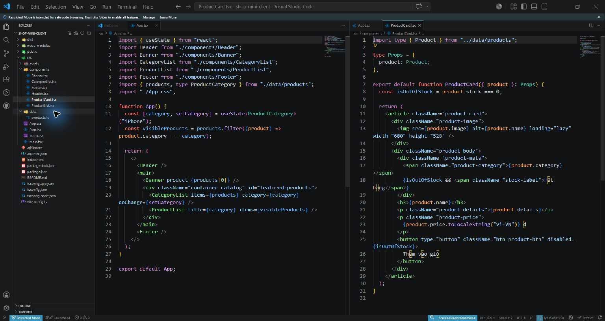

# Lab 01 – iMeoShop

**Sinh viên:** Võ Phạm Thiên Tân
**Môn học:** Công nghệ lập trình hiện đại

iMeoShop là trang chủ cửa hàng thiết bị Apple, được phát triển từ bài Lab 1 ShopMini bằng React, TypeScript và Vite.

## Nội dung bài

- Trang chủ có thanh điều hướng, banner, danh mục, lưới sản phẩm và chân trang.
- Có 32 mẫu hoặc cấu hình, chia đều cho iPhone, iPad, Mac và Apple Watch. Chọn danh mục để xem 8 sản phẩm tương ứng.
- Sản phẩm hết hàng có nhãn trạng thái và nút thêm vào giỏ bị khóa. Giá, tồn kho và giỏ hàng dùng để minh họa.
- Ảnh sản phẩm lấy từ [Apple Việt Nam](https://www.apple.com/vn/) và được lưu trong thư mục public/images/apple.

## Chạy project

    npm ci
    npm run dev

Mở [localhost:5173](http://localhost:5173) để xem trang.

## Ảnh minh chứng

### Trang chủ iMeoShop

### Mã nguồn trong VS Code

