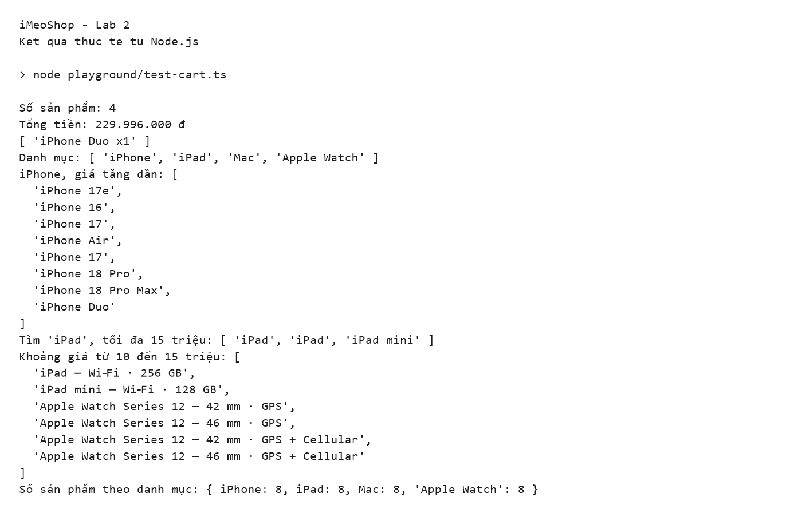
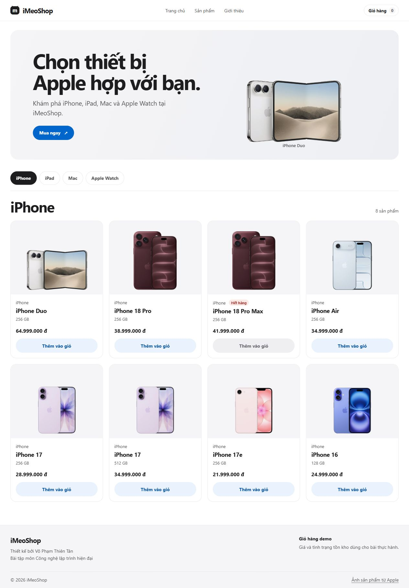

# Lab 01 – iMeoShop

**Sinh viên:** Võ Phạm Thiên Tân
**Môn học:** Công nghệ lập trình hiện đại

iMeoShop là trang chủ cửa hàng thiết bị Apple, được phát triển từ bài Lab 1 ShopMini bằng React, TypeScript và Vite.

## Nội dung bài

- Trang chủ có thanh điều hướng, banner, danh mục, lưới sản phẩm và chân trang.
- Có 32 mẫu hoặc cấu hình, chia đều cho iPhone, iPad, Mac và Apple Watch. Chọn danh mục để xem 8 sản phẩm tương ứng.
- Sản phẩm hết hàng có nhãn trạng thái và nút thêm vào giỏ bị khóa. Giá, tồn kho và giỏ hàng dùng để minh họa.
- Ảnh sản phẩm lấy từ [Apple Việt Nam](https://www.apple.com/vn/) và được lưu trong thư mục public/images/apple.

## Chạy project

    npm ci
    npm run dev

Mở [localhost:5173](http://localhost:5173) để xem trang.

## Ảnh minh chứng

## Lab 2 – Thư viện hàm TypeScript

- Chạy 9 phần ES6+ bằng `node playground/es6.ts`.
- Chạy thử giỏ hàng, bộ lọc, khoảng giá và thống kê danh mục bằng `node playground/test-cart.ts`.
- Kiểm tra kiểu playground bằng `npx tsc -p playground/tsconfig.json`.
- `src/utils/cart.ts` có 5 hàm xử lý giỏ hàng theo cách trả về mảng mới.
- Trang chủ có khu theo danh mục, giá đến 15 triệu đồng, điện thoại iPhone và sản phẩm sắp hết hàng (tồn kho từ 1 đến 5).
- Bài tập về nhà có `searchByPriceRange` (gồm cả hai biên) và `groupByCategory`.
- Ví dụ lọc dùng giá và danh mục Apple. Giỏ thử có 3 iPhone Duo và 1 iPhone Air, tổng 229.996.000 đ. Sau cập nhật và xóa còn iPhone Duo x1.

### Kết quả chạy Lab 2

Ảnh trên được dựng từ kết quả thực tế của lệnh Node.js, do công cụ chụp màn hình terminal chưa kết nối được. Kết quả nguyên văn nằm trong [Lab2_test_cart.txt](docs/images/Lab2_test_cart.txt).

### Tự kiểm tra spread

Sau khi tạo `updated = { ...product, price: 27999000 }`, nếu gán `product.price = 0` thì `updated.price` vẫn là 27999000. Spread tạo một đối tượng mới. Đây là sao chép nông, các đối tượng hoặc mảng lồng bên trong vẫn dùng chung tham chiếu nếu chưa được sao chép riêng. Khi cập nhật state của React, tạo bản mới rồi gọi hàm cập nhật state để React nhận biết thay đổi.

### Đọc trước buổi 3

- `useState` lưu trạng thái giữa các lần render. Trong App, `category` là danh mục hiện tại và `setCategory` dùng để cập nhật.
- `onClick` xử lý thao tác bấm. Nút danh mục gọi `onChange(item)`, prop này nhận hàm `setCategory` từ App.
- Sự kiện `onChange` của ô nhập nhận sự kiện và có thể dùng `event.target.value` để cập nhật state.
- `outOfStock && Hết hàng` là hiển thị có điều kiện. `disabled` khóa nút mua khi hết hàng.

## Ảnh Lab 1

### Trang chủ iMeoShop

### Mã nguồn trong VS Code

